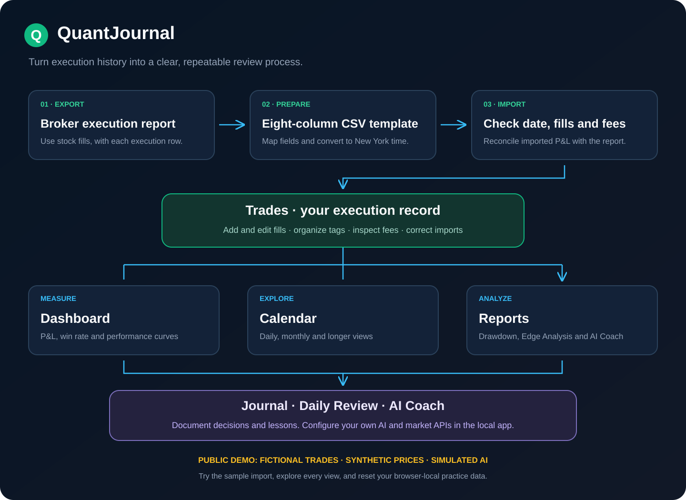

# QuantJournal — Local Trading Journal

QuantJournal is a local, self-hosted trading journal for stock traders. Import broker executions, analyze trading performance, keep a daily journal, and generate reviews through your own AI and market-data connections. The full application runs on your computer; the GitHub Pages demo uses fictional data. New local installations start empty.

## Install and run

Requires Node.js 22.18+ and npm.

```sh
npm ci
npm run setup
npm run dev
```

Open http://localhost:3000. The server binds to the local loopback interface. Production: npm run build, then npm run start.

SQLite, encrypted API settings, the encryption key and cached market bars are stored under .local/. None are included in the repository. The encryption key is kept on the same machine; encryption is not protection against someone who has full access to that machine. Configure credentials in **AI & Market Settings**. Never upload .local, .env, databases, logs or your trading exports.

## Interactive demo and walkthrough

[Open the public demo](https://sirusai.github.io/QuantJournal-Local-Trading-Journal/#/dashboard) · [Practice broker import](https://sirusai.github.io/QuantJournal-Local-Trading-Journal/#/import-guide) · [Watch the two-minute tour](https://sirusai.github.io/QuantJournal-Local-Trading-Journal/#/tour)

Explore all remaining features using fictional trades and browser-local editing. AI and market data are clearly labeled simulations; real credentials are disabled in the public demo. Run `npm run demo:build` followed by `npm run demo:preview`, then open `http://127.0.0.1:4173/#/dashboard`. Windows users can run `run_Demo.bat`.



[Broker import tutorial](docs/BROKER_IMPORT.md) · [Two-minute video](public/media/quantjournal-tour.mp4) · [GitHub Pages publishing and Remotion source](docs/DEMO.md)

## CSV format

Import files use Time,Symbol,Price,Side,Quantity,Fee,Route,Pnl columns. Times are New York local time. Pnl is optional and treated as broker-reported net P&L when present; otherwise net P&L is calculated from signed cash flows minus fees for complete round trips. Unmatched fills require broker-reported Pnl so cash outlays are not misrepresented as realized losses. Trade volume is the sum of absolute fill quantities.

Use the eight-column header and one CSV per trading date. Download the [blank template](public/imports/blank-template.csv), [fictional $19 net P&L example](public/imports/06-30-2026.csv), or [pasted-table example](public/imports/smart-import.tsv). Choose **How to Import Broker Trades** beside the app’s import controls for the illustrated guide. Excel/PDF exports must first be converted and checked; arbitrary statement recognition is not included. Signed fee rebates are supported. Invalid batches are rejected before saving, and import results include duplicate counts.

## Bring your own AI

Supported templates: OpenAI Responses, DeepSeek, Google AI Studio, Claude Messages, OpenRouter, Nvidia NIM, Ollama and OpenAI-compatible endpoints such as LM Studio.

Add a connection name, Base URL, model ID, your key and timeout. Save, then test with a short generic prompt. Model IDs can be typed manually or refreshed when the endpoint supports listing. Keys are not returned by the settings API; blank keeps a saved key, and the explicit clear checkbox removes it.

Choose independent defaults for Daily Review, AI Coach and Edge Analysis. Generating analysis sends the selected data to the chosen endpoint. Daily Review excludes trade notes unless you enable them. Saved reviews and history remain available after deleting a connection. No AI credentials are bundled.

## Market data

Daily and intraday sources can be chosen independently:
- **yfinance**: default free Python option, intended for personal use. Install with npm run setup:market-data, then use Check Python in Settings. Python 3.10+ is required. You may specify another Python executable.
- **Massive**: enter your own key and plan. Free and paid plans have different history, rate limits and permissions. See https://massive.com/pricing?product=stocks; no subscription is supplied with this project.
- **Custom HTTP API**: configure a GET URL, query mappings, authentication and OHLCV field mappings.

Default intraday bars are 5m. Conservative yfinance windows: 1m about 8 days; 2m/5m/15m/30m/90m about 60 days; 60m about 730 days. Daily history depends on the ticker. Actual availability can vary; there is no guaranteed free request quota. See the yfinance documentation and source. A coarser interval is never silently substituted.

Charts display the provider, interval, coverage and price basis. Yahoo OHLC may already incorporate stock splits even when auto_adjust=False; it is not labeled unadjusted. Execution-price overlays and exact price evaluation require unadjusted 1m data. Trade records are always displayed at their actual saved prices and quantities.

Missing, out-of-range, rate-limited or unauthorized market requests are shown explicitly. Random market bars are never generated. Reviews can still use trading evidence without market data. Optional news and macro context can be enabled in Settings; historical news must match the selected date.

## Custom OHLCV API contract

The interface uses GET. The URL and query values support {symbol}, {from}, {to}, {interval}, {prepost}. Dates use YYYY-MM-DD with inclusive boundaries; map them to your upstream provider's semantics.

Example query mapping:
```json
{"symbol":"{symbol}","start":"{from}","end":"{to}","interval":"{interval}"}
```

Example response:
```json
{"bars":[{"time":1791898200,"open":100,"high":102,"low":99,"close":101,"volume":1200}]}
```

Set array path to bars (blank for a root array), configure nested dot paths for fields and choose seconds, milliseconds or ISO timestamps. Provide the exchange timezone, price-adjustment basis, supported intervals and any maximum history window. Authentication supports none, Bearer, a named header or a named query parameter. Secrets stay server-side. No user scripts are executed.

All bars are normalized to UTC seconds and exchange session dates. The internal MarketDataProvider accepts symbol/from/to/interval/prepost and returns bars plus source, actual interval, adjustment, coverage and limitations.

## Checks and release preparation

```sh
npm test
npm run typecheck
npm run build
npm run check:release
```

See [docs/TESTING.md](docs/TESTING.md) for manual acceptance checks and [docs/PRIVACY_REVIEW.md](docs/PRIVACY_REVIEW.md) for the pre-publication privacy review. Before uploading, run the release check and include source only. Do not add local records or credentials to Git. Market and AI calls incur the costs and limits of your own accounts.
