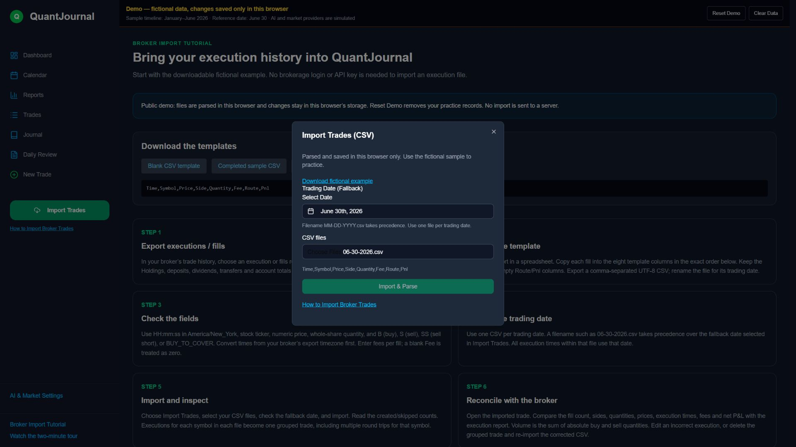
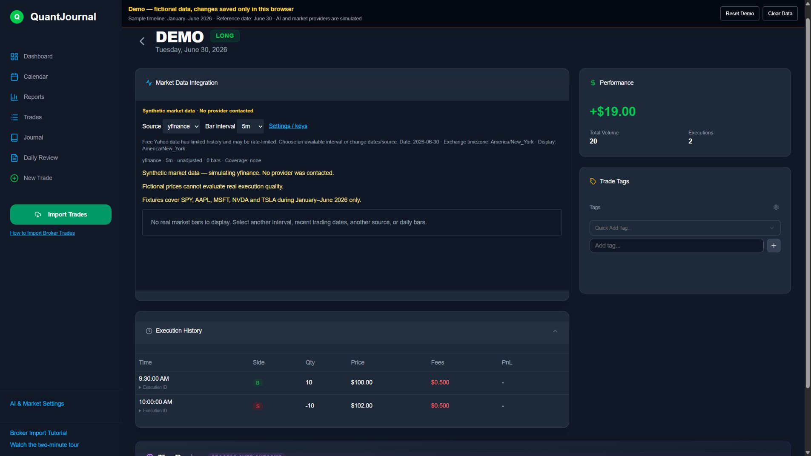

# Import broker execution records

Use a stock execution/fills export from your broker. Exporting is different from placing an order: QuantJournal records the executions you already made. No brokerage login or API key is needed for file import.

## Practice first

Download [the completed fictional sample](../public/imports/06-30-2026.csv) and [the blank CSV template](../public/imports/blank-template.csv). In the demo, open **How to Import Broker Trades → Try Sample Import**. In the local app, choose **Import Trades** and select the downloaded sample.

The sample buys 10 DEMO shares at $100 and sells 10 at $102. Each fill costs $0.50. Check these results: **two fills, volume 20, gross P&L $20, fees $1, net P&L $19**. DEMO is a fictional symbol and has no market-data fixture.



## Convert your broker export

1. Open the broker’s trade history or execution report and export stock fills to CSV. Menu names differ between brokers. Do not use holdings, transfers, dividends, account totals, or a trade-confirmation summary without the individual fills.
2. Open the export in a spreadsheet. Copy the relevant fields into the template, one row per fill. Keep the eight columns in exactly this order:

```csv
Time,Symbol,Price,Side,Quantity,Fee,Route,Pnl
09:30:00,DEMO,100.00,B,10,0.50,,
10:00:00,DEMO,102.00,S,10,0.50,,
```

| Column | Meaning |
|---|---|
| Time | Execution time, `HH:mm:ss`, converted to America/New_York. Daylight saving time is handled for the selected trading date. |
| Symbol | Stock/ETF ticker. |
| Price | Numeric execution price. |
| Side | `B`/`BUY`, `S`/`SELL`, `SS`/`SELL_SHORT`, or `BC`/`BUY_TO_COVER`. |
| Quantity | Whole-share fill quantity. Prefer a positive quantity; the side determines the stored sign. |
| Fee | Per-fill cost. Positive means a charge, negative means a rebate. Blank means zero; missing fees are not inferred. |
| Route | Optional execution venue text. Keep the column even when empty. |
| Pnl | Optional broker-reported **net** realized P&L for that fill. Blank means calculate; `0` is an explicit reported zero. |

3. Use one CSV per trading date. Rename it `MM-DD-YYYY.csv`, for example `06-30-2026.csv`. That filename overrides the fallback date in the import dialog. If the filename contains no recognized date, choose the correct fallback date. Separate multi-day exports before importing.
4. Export a comma-separated UTF-8 CSV. A CSV must contain the header and all eight columns, including empty Route and Pnl fields. Quote fields containing commas using standard CSV quoting.
5. Choose **Import Trades**, select one or more compatible CSVs, check the fallback date, then choose **Import & Parse**. Read the created and skipped counts. Invalid files are rejected before anything in that import is saved.
6. Open **Trades → View Details → Execution History**. Compare every fill, its time, side, quantity, price, fees and net P&L with the broker report. Edit an incorrect execution, or delete the incorrect grouped trade and re-import a corrected file.



## Important accounting details

- Each symbol within each file becomes one grouped trade. Multiple round trips for that symbol in the file are combined. Volume counts both entry and exit fills.
- With no reported Pnl, buys and sells must balance for each symbol. Net P&L is signed cash flow minus fees. Unmatched fills require broker-reported realized Pnl; this importer does not reconstruct positions carried across dates.
- When Pnl is supplied on any fill, those reported net values are summed. Fees are not deducted twice. Do not repeat a daily or account total on every row. If your broker exports gross P&L, convert it to net before putting it in Pnl.
- For the sample, reported net Pnl could be blank on the buy and `19.00` on the sale. It must not be `19.00` on both rows.
- Duplicate detection compares symbol, date, total volume, and net P&L. An identical import is skipped. A changed file can create another grouped trade; remove the incorrect original before importing a replacement.
- The interface displays dollar amounts and performs no currency conversion. Whole-share stock quantities are supported; fractional shares and option/futures contract multipliers are not handled by this format.

## Paste a compatible table

Download [the tab-separated example](../public/imports/smart-import.tsv). Choose **New Trade → Smart Format** and paste the table, including its header:

`TradeDate, ExecutionTime, BuySell, Symbol, OrderId, Quantity, Price, Fee, Pnl` — separated by tabs, not commas.

TradeDate accepts `M/D/YYYY` or `YYYY-MM-DD`. ExecutionTime is a New York wall time or a timezone-free timestamp such as `2026-06-30T09:30:00`. The first seven columns are required in that order. OrderId is an unused placeholder; Fee and Pnl are optional trailing columns. Multiple dates can be pasted because this format includes TradeDate. It uses the same validation and P&L calculation as CSV import.

## Documents and troubleshooting

Excel workbooks must be exported to the compatible CSV. PDF statements and screenshots require extracting and manually checking the execution rows before copying them into the template. Automatic recognition of arbitrary broker statements is not included.

For an error, check the displayed row number, header order, filename date, New York time format, side code, numeric price/quantity/fee, and balanced fills. Keep Route and Pnl columns even when blank. Do not remove fees merely to make a file import successfully; reconcile against the broker report.

In the public demo, files are parsed in the browser and edits stay in that browser’s storage. In the local application, files are sent to your own local server and records are saved in its SQLite database. The demo’s AI and charts are simulations; use your local installation for real trading history and your own API connections.
